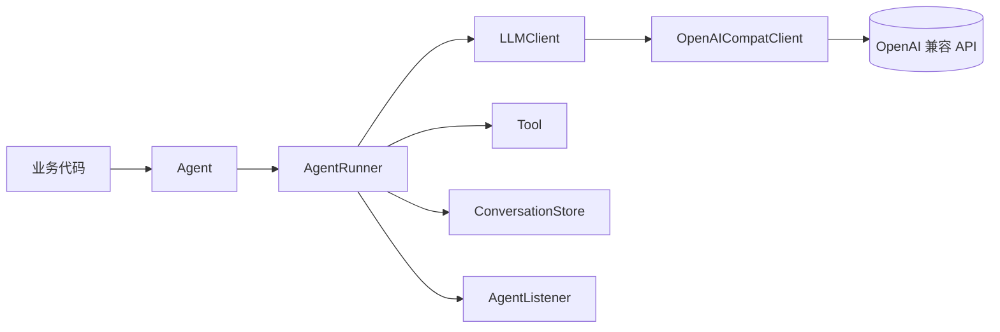
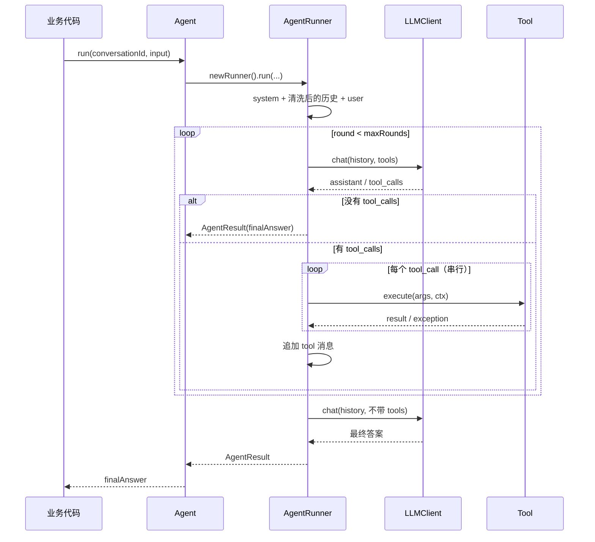

# 架构与设计取舍

这份文档写给想改源码的人。README 讲怎么用，这里讲为什么这么写。

## 1. 目标与非目标

目标：

- 一个 jar、零运行时依赖、JDK 17；
- 兼容 OpenAI Chat Completions 协议；
- 同步 Agent 循环，可选流式；
- 工具调用、会话持久化 SPI、运行监听器；
- API 面尽量小，业务项目里一个 `@Bean` 能接上。

非目标：

- RAG、向量库、文档解析；
- 多 Agent、工作流编排、可视化；
- 模型路由、API 网关、配额管理；
- 上下文压缩、摘要、限流、重试；
- Spring Boot Starter。

边界越清楚，库越不容易长成自己不想要的样子。

## 2. 模块与依赖方向



依赖方向是单向的，没有循环：

```
core          -> llm, tool, message, conversation, json
llm           -> message, tool, json
conversation  -> message, json
message       -> json
tool          -> (无)
json          -> (无)
```

`Agent` 是门面，负责组装；`AgentRunner` 才是循环的实现。普通用户不需要碰 `AgentRunner`。

## 3. 一次 run 的流程



几个容易被忽略的顺序问题：

1. **assistant 消息先入 history，再执行工具**。工具结果作为 `tool` 消息跟在后面，
   这是 OpenAI 协议要求的顺序。
2. **工具异常不终止循环**。异常 message 会变成一条 `[error] ...` 的 tool 消息，
   让模型自己决定重试、换参数还是道歉。
3. **只有拿到最终答案才落库**。LLM 调用抛异常时，这一轮的 user 消息也不会保存。
4. **达到 maxRounds 后再调一次 LLM，但不带 tools**。否则模型可能继续要求调工具，
   而循环已经退出，history 里会留下没有结果的 `tool_calls`。

## 4. 关键决策

### 4.1 手写 MiniJson，而不是 Jackson / Gson

原因很直接：用户加一行依赖，不应该被动接受一棵 JSON 依赖树。OpenAI Chat Completions
用到的 JSON 子集很小，写一个几百行的解析器完全够用。

代价也要说清楚：

- 只支持 object / array / string / number / boolean / null；
- 不支持注解绑定、日期、枚举、复杂泛型；
- 数字按大小解析成 `Integer` / `Long` / `BigInteger`，小数统一 `Double`；
- 嵌套深度上限 512，防止畸形输入递归爆栈；
- 性能不是强项，别拿它解析几十 MB 的日志。

如果你的业务需要复杂 JSON，不要扩展 MiniJson。在自己的 `ConversationStore` 里用
Jackson 存成自己的结构，读出来再转成 `ChatMessage` 即可。

### 4.2 `ChatMessage` 不用 record

`ChatMessage` 有四种角色、可选的 `toolCalls`、可选的 `toolCallId` / `toolName`。
用 record 的话，规范构造器会暴露一堆 `null`，静态工厂反而更清楚：

```java
ChatMessage.system("...");
ChatMessage.user("...");
ChatMessage.assistant("...", toolCalls);
ChatMessage.tool(callId, name, result);
```

`AgentResult` 没有这个问题，所以用了 record。

### 4.3 同一轮工具串行执行

`AgentRunner` 里就是一个 `for` 循环。这样做的理由：

- 工具可能有依赖关系（先查订单，再查物流）；
- 不用引入线程池，也不用考虑 `ToolContext` 的线程传播；
- 出错顺序、日志顺序、listener 回调顺序都是确定的。

代价是延迟。如果同一轮有 5 个互不依赖的慢工具，串行会很慢。并发执行在 Roadmap 里，
但会做成可开关，默认行为不变。

### 4.4 工具异常吞掉，LLM 异常抛出

这两类错误的处理方式不一样：

| 错误 | 处理 | 原因 |
| --- | --- | --- |
| 工具抛异常 | 转成 `[error] ...` tool 消息 | 通常是参数错、资源不存在，模型可以纠正 |
| 工具名不存在 | `[error] no such tool: xxx` | 同上，让模型知道工具列表变了 |
| 参数 JSON 解析失败 | `IllegalArgumentException`，被捕获后回灌 | 模型偶尔会吐坏 JSON |
| LLM HTTP 非 2xx | `LLMException` 直接抛 | 鉴权、限流、服务端错误，重试策略应由调用方决定 |
| LLM 返回非法 JSON | `LLMException` 直接抛 | 继续循环没有意义 |
| 会话保存失败 | `IllegalStateException` | 明确告诉调用方“这一轮没存上” |

工具异常只保留 message，不把整个堆栈回灌给模型——堆栈又长又贵，模型也看不懂。
需要排查时用 `AgentListener.onToolCallEnd` 拿原始结果。

### 4.5 maxRounds 之后强制收尾

循环退出时，history 里可能刚追加了一个带 `tool_calls` 的 assistant，但还没执行工具。
这时如果直接返回，会有两个问题：

- 没有最终答案；
- 历史里留下悬空的 `tool_calls`，下次加载会被清洗掉，用户会觉得“怎么失忆了”。

所以退出循环后再调一次 LLM，传空工具列表，并且**丢弃响应里的 tool_calls**。
模型只能基于已有结果说话。如果它还是不吐内容，返回一句明确的中文提示，而不是空字符串。

### 4.6 历史清洗用状态机

`AgentRunner.sanitizeHistory` 是一个三状态机：

```
NEED_USER -> NEED_ASSISTANT -> NEED_TOOL -> NEED_ASSISTANT -> ...
```

`checkpoint` 记录最后一个“完整 assistant”的位置。任何不符合序列的消息（未回答的 user、
缺 tool 结果的 assistant、重复的 tool_call_id、半个工具链）都会让函数截断到 checkpoint。

为什么不在保存时保证完整？因为历史可能来自：

- 上一版本写的旧数据；
- 被人工改过的 Redis / MongoDB；
- 并发写覆盖后的半截数据；
- 用户自己实现的 store 返回了脏数据。

加载时清洗比保存时校验更稳，成本也低。

### 4.7 SSE 用 index 聚合，不靠数组顺序

流式响应里，`tool_calls` 的分片可能交错到达：

```
chunk 1: index=0, id=call_1, name=get_weather
chunk 2: index=1, id=call_2, name=get_time, arguments={"tz":
chunk 3: index=0, arguments={"city":"北京"}
chunk 4: index=1, arguments="UTC"}
```

所以用 `TreeMap<Integer, ToolCallBuilder>`，按 `index` 归位，而不是按到达顺序拼。
`id` 和 `name` 只取第一次出现的非空值，`arguments` 是无脑追加。

其他边界：

- `data:` 前缀、空行、以 `:` 开头的注释行都要跳过；
- `[DONE]` 直接结束，后面的数据不处理；
- 一个 chunk 都没有，抛 `LLMException`，避免把空字符串当答案；
- 网关忽略 `stream=true` 返回整段 JSON 时，降级走普通解析；
- 如果返回的是 SSE 但 `Content-Type` 不是 `text/event-stream`，按内容特征再判断一次。

### 4.8 HTTP 只用 JDK 自带客户端

`OpenAICompatClient` 内部持有一个 `HttpClient`：

- 连接超时固定 15 秒；
- 请求超时用 `timeoutSeconds`，默认 120 秒；
- 不配代理、不配连接池、不做重试；
- `apiKey` 为空时不发 `Authorization` 头，方便本地 Ollama。

需要代理、mTLS、自定义重试时，不要改这个类，实现自己的 `LLMClient` 包一层更干净。

## 5. 线程安全与并发

- `Agent` 构造完之后不可变，可以作为单例 Bean 共享。
- 每次 `run` 都新建 `AgentRunner`，运行状态不共享。
- `AgentListener` 的回调发生在调用 `run` 的线程上。不要在回调里做阻塞操作，
  更不要在里面再调同一个 `Agent`。
- `InMemoryConversationStore` 用 `ConcurrentHashMap`，但**不保证同一个
  `conversationId` 的读-改-写原子性**。同一会话并发跑两次，后保存的会覆盖先保存的。
- `ToolContext` 的属性 map 是不可变的，可以安全传给多个工具。

## 6. 扩展点

| 扩展点 | 用途 | 注意 |
| --- | --- | --- |
| `LLMClient` | 接非 OpenAI 协议的模型 | 至少实现 `chat`；要真流式再覆写 `chatStream` |
| `Tool` | 自定义工具 | 返回值要短；异常 message 会回灌给模型 |
| `ConversationStore` | Redis / MongoDB / 数据库 | 原样存取，不要改写消息内容 |
| `AgentListener` | 日志、指标、 tracing | 回调在调用线程，别阻塞 |
| `ToolContext` | 向工具传业务上下文 | 只读 map，值需要自己保证线程安全 |

不要扩展 `MiniJson` 和 `AgentRunner` 的内部实现。前者保持小，后者保持可读。

## 7. 已知取舍

- 没有重试：重试策略和业务幂等性强相关，库不该替用户决定。
- 没有上下文裁剪：不同模型的窗口、不同业务的保留策略差异太大。
- 没有工具并发：先保证正确和可观测，再谈吞吐。
- 没有指标：`AgentListener` 已经能拿到轮次、工具耗时、错误，接 Micrometer 是几行代码。
- 没有 Starter：一个 `@Bean` 就能解决，Starter 会引入 Spring 依赖，违背零依赖目标。
- 没有 JUnit：离线自测用 `main + assert`，CI 直接跑，构建期不需要测试依赖。
